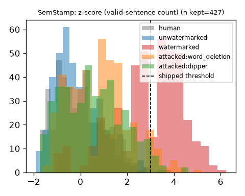
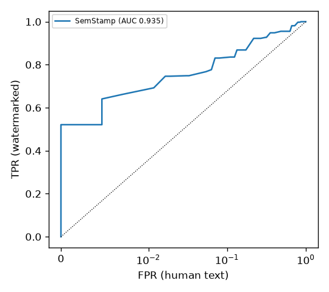
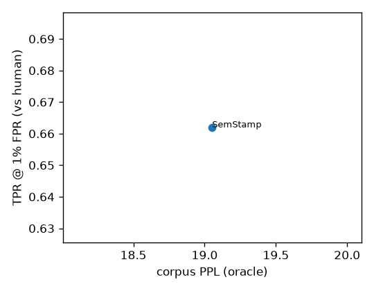

# wmbench results: `opt13b`

Model: `facebook/opt-1.3b` | oracle: `facebook/opt-2.7b` | device: cuda (float16) | MarkLLM: `0a4fe8c6` | config hash: `49b0c5450b2e`

## Main table

| variant | ppl_corpus | ppl_median | diversity | tok/s | n_err | auroc_vs_human | tpr@1%fpr_vs_human | auroc_vs_none | tpr@1%fpr_vs_none | fixed_thr_tpr | fixed_thr_fpr | attacked_tpr_word_deletion | attacked_tpr_dipper |
|---|---|---|---|---|---|---|---|---|---|---|---|---|---|
| SemStamp | 19.053 | 18.564 | 0.965 | 11.581 | 0 | 0.935 | 0.662 | 0.936 | 0.641 | 0.493 | 0.000 | 0.106 | 0.094 |
| human | 10.537 | 10.287 | 0.948 | - | 0 | - | - | - | - | - | - | - | - |

Detection columns use C4 continuations; negatives are human continuations (`vs_human`) or the `none` variant's generations (`vs_none`). Per sample and variant the watermarked, human and `none` texts are scored at one common token budget (the shortest of the three, at most `max_new_tokens`); samples whose budget is below `min_detect_tokens` (50) are excluded (`n_gen_ok` vs `n_samples_kept` in detection_summary.csv). `fixed_thr_*` use each algorithm's shipped threshold. `attacked_tpr_<attack>` is the TPR of the attacked watermarked texts at the threshold fixed on the clean human negatives; attack strength is in `attack_len_ratio_*`, `attack_bleu_vs_source_*` and `attack_sim_embed_*` of detection_summary.csv. `tpr@1%fpr` is unreliable when fewer than 100 negatives are available (see `fpr_warning_*` in detection_summary.csv).

## Detection

| dataset | variant | score | n_gen_ok | n_samples_kept | n_pos | n_pos_nan | pos_mean | detect_tokens_mean | pos_tokens_mean | n_neg_human | neg_tokens_mean_human | neg_mean_human | auroc_human | auroc_human_ci | tpr@1%fpr_human | tpr@5%fpr_human | tpr@1%fpr_human_ci | best_f1_human | fixed_thr_tpr_human | fixed_thr_fpr_human | fpr_warning_human | n_neg_none | neg_tokens_mean_none | neg_mean_none | auroc_none | auroc_none_ci | tpr@1%fpr_none | tpr@5%fpr_none | tpr@1%fpr_none_ci | best_f1_none | fixed_thr_tpr_none | fixed_thr_fpr_none | fpr_warning_none | attacks | attacked_n_word_deletion | attacked_tpr_at_clean_thr_word_deletion | attacked_auroc_human_word_deletion | attacked_fixed_thr_tpr_word_deletion | attacked_tokens_mean_word_deletion | attack_len_ratio_word_deletion | attack_bleu_vs_source_word_deletion | attack_sim_embed_word_deletion | attacked_n_dipper | attacked_tpr_at_clean_thr_dipper | attacked_auroc_human_dipper | attacked_fixed_thr_tpr_dipper | attacked_tokens_mean_dipper | attack_len_ratio_dipper | attack_bleu_vs_source_dipper | attack_sim_embed_dipper | fixed_threshold | nominal_fpr |
|---|---|---|---|---|---|---|---|---|---|---|---|---|---|---|---|---|---|---|---|---|---|---|---|---|---|---|---|---|---|---|---|---|---|---|---|---|---|---|---|---|---|---|---|---|---|---|---|---|---|---|---|---|
| c4 | SemStamp | z-score (valid-sentence count) | 500 | 427 | 426 | 1 | 2.868 | 170.286 | 170.283 | 427 | 170.286 | -0.051 | 0.935 | [0.92, 0.95] | 0.662 | 0.749 | [0.52, 0.76] | 0.874 | 0.493 | 0.000 | False | 425 | 170.276 | -0.059 | 0.936 | [0.92, 0.95] | 0.641 | 0.749 | [0.35, 0.70] | 0.877 | 0.493 | 0.005 | False | word_deletion, dipper | 416 | 0.106 | 0.681 | 0.048 | 114.691 | 0.674 | 41.304 | 0.880 | 427 | 0.094 | 0.638 | 0.028 | 160.876 | 1.009 | 25.385 | 0.852 | 3.000 | 0.001 |

## Quality per dataset

| dataset | variant | n_ok | n_err | n_ok_quality | n_err_quality | cont_tokens_mean | gen_seconds_mean | tokens_per_second | ppl_corpus | ppl_median | ppl_mean | ppl_ci | diversity | rep_2 | log_diversity_markllm | oracle |
|---|---|---|---|---|---|---|---|---|---|---|---|---|---|---|---|---|
| c4 | SemStamp | 500 | 0 | 500 | 0 | 159.812 | 13.799 | 11.581 | 19.053 | 18.564 | 22.844 | [17.54, 19.77] | 0.965 | 0.026 | 11.083 | facebook/opt-2.7b |
| c4 | human | 0 | 0 | 500 | 0 | - | - | - | 10.537 | 10.287 | 11.461 | [9.93, 10.73] | 0.948 | 0.038 | 8.432 | facebook/opt-2.7b |

## Paired differences vs `none` (same prompts, bootstrap 95% CI)

| dataset | variant | metric | n_pairs | delta_vs_none | ci_low | ci_high |
|---|---|---|---|---|---|---|
| c4 | SemStamp | log_ppl | 500 | -0.004 | -0.061 | 0.053 |
| c4 | SemStamp | diversity | 500 | 0.005 | -0.004 | 0.013 |

## Plots

