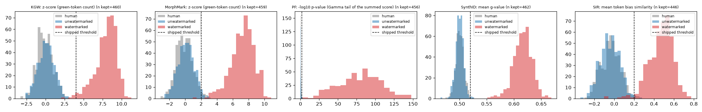
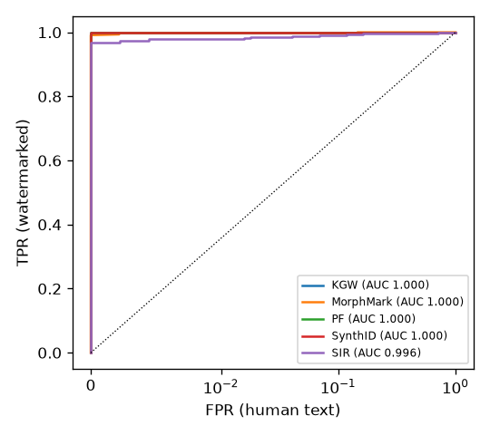
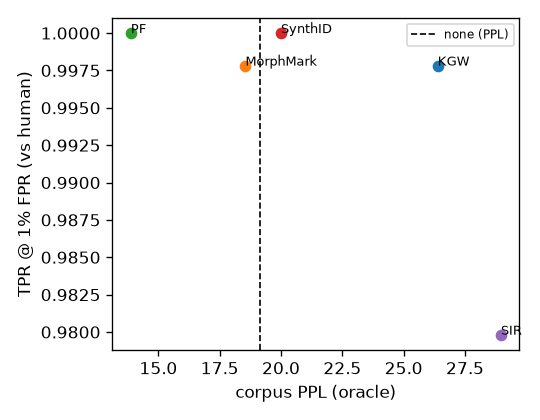
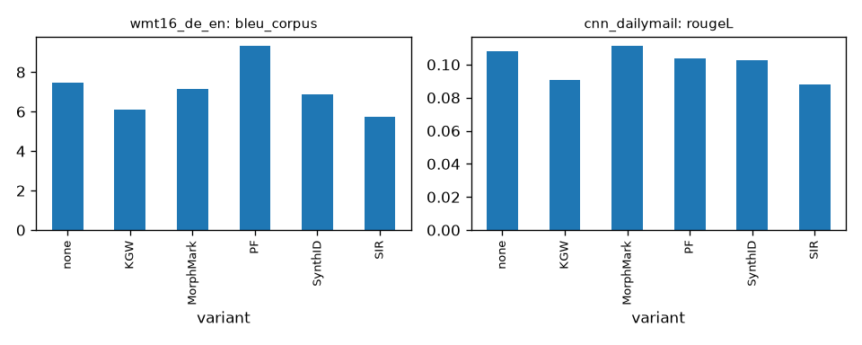

# wmbench results: `opt13b`

Model: `facebook/opt-1.3b` | oracle: `facebook/opt-2.7b` | device: cuda (float16) | MarkLLM: `0a4fe8c6` | config hash: `49b0c5450b2e`

## Main table

| variant | ppl_corpus | ppl_median | diversity | tok/s | n_err | bleu | rougeL | auroc_vs_human | tpr@1%fpr_vs_human | auroc_vs_none | tpr@1%fpr_vs_none | fixed_thr_tpr | fixed_thr_fpr |
|---|---|---|---|---|---|---|---|---|---|---|---|---|---|
| none | 19.124 | 18.415 | 0.960 | 48.185 | 0 | 7.480 | 0.108 | - | - | - | - | - | - |
| KGW | 26.389 | 26.200 | 0.953 | 46.514 | 0 | 6.108 | 0.091 | 1.000 | 0.998 | 1.000 | 0.998 | 0.989 | 0.000 |
| MorphMark | 18.550 | 18.271 | 0.933 | 44.327 | 0 | 7.132 | 0.111 | 1.000 | 0.998 | 1.000 | 0.998 | 0.998 | 0.028 |
| PF | 13.878 | 14.574 | 0.919 | 48.110 | 0 | 9.314 | 0.104 | 1.000 | 1.000 | 1.000 | 1.000 | 1.000 | 0.007 |
| SynthID | 19.999 | 20.000 | 0.959 | 39.163 | 0 | 6.861 | 0.103 | 1.000 | 1.000 | 1.000 | 1.000 | 1.000 | 0.004 |
| SIR | 28.966 | 29.032 | 0.952 | 21.204 | 0 | 5.716 | 0.088 | 0.996 | 0.980 | 0.996 | 0.980 | 0.980 | 0.009 |
| human | 10.537 | 10.287 | 0.948 | - | 0 | - | - | - | - | - | - | - | - |

Detection columns use C4 continuations; negatives are human continuations (`vs_human`) or the `none` variant's generations (`vs_none`). Per sample and variant the watermarked, human and `none` texts are scored at one common token budget (the shortest of the three, at most `max_new_tokens`); samples whose budget is below `min_detect_tokens` (50) are excluded (`n_gen_ok` vs `n_samples_kept` in detection_summary.csv). `fixed_thr_*` use each algorithm's shipped threshold. `attacked_tpr_<attack>` is the TPR of the attacked watermarked texts at the threshold fixed on the clean human negatives; attack strength is in `attack_len_ratio_*`, `attack_bleu_vs_source_*` and `attack_sim_embed_*` of detection_summary.csv. `tpr@1%fpr` is unreliable when fewer than 100 negatives are available (see `fpr_warning_*` in detection_summary.csv).

## Detection

| dataset | variant | score | n_gen_ok | n_samples_kept | n_pos | n_pos_nan | pos_mean | detect_tokens_mean | pos_tokens_mean | n_neg_human | neg_tokens_mean_human | neg_mean_human | auroc_human | auroc_human_ci | tpr@1%fpr_human | tpr@5%fpr_human | tpr@1%fpr_human_ci | best_f1_human | fixed_thr_tpr_human | fixed_thr_fpr_human | fpr_warning_human | n_neg_none | neg_tokens_mean_none | neg_mean_none | auroc_none | auroc_none_ci | tpr@1%fpr_none | tpr@5%fpr_none | tpr@1%fpr_none_ci | best_f1_none | fixed_thr_tpr_none | fixed_thr_fpr_none | fpr_warning_none | fixed_threshold | nominal_fpr |
|---|---|---|---|---|---|---|---|---|---|---|---|---|---|---|---|---|---|---|---|---|---|---|---|---|---|---|---|---|---|---|---|---|---|---|---|
| c4 | KGW | z-score (green-token count) | 500 | 460 | 460 | 0 | 7.965 | 182.411 | 182.411 | 460 | 182.409 | -0.094 | 1.000 | [1.00, 1.00] | 0.998 | 1.000 | [0.99, 1.00] | 0.999 | 0.989 | 0.000 | False | 460 | 182.404 | 0.051 | 1.000 | [1.00, 1.00] | 0.998 | 1.000 | [0.99, 1.00] | 0.999 | 0.989 | 0.000 | False | 4.000 | 0.000 |
| c4 | MorphMark | z-score (green-token count) | 500 | 459 | 459 | 0 | 7.227 | 182.941 | 182.937 | 459 | 182.941 | -0.108 | 1.000 | [1.00, 1.00] | 0.998 | 0.998 | [0.99, 1.00] | 0.998 | 0.998 | 0.028 | False | 459 | 182.939 | 0.042 | 1.000 | [1.00, 1.00] | 0.998 | 0.998 | [0.99, 1.00] | 0.997 | 0.998 | 0.022 | False | 2.000 | 0.023 |
| c4 | PF | -log10 p-value (Gamma tail of the summed score) | 500 | 456 | 456 | 0 | 79.722 | 184.904 | 184.901 | 456 | 184.904 | 0.449 | 1.000 | [1.00, 1.00] | 1.000 | 1.000 | [1.00, 1.00] | 0.999 | 1.000 | 0.007 | False | 456 | 184.904 | 0.428 | 1.000 | [1.00, 1.00] | 1.000 | 1.000 | [1.00, 1.00] | 0.999 | 1.000 | 0.018 | False | 2.000 | 0.010 |
| c4 | SynthID | mean g-value | 500 | 462 | 462 | 0 | 0.616 | 181.448 | 181.448 | 462 | 181.448 | 0.501 | 1.000 | [1.00, 1.00] | 1.000 | 1.000 | [1.00, 1.00] | 1.000 | 1.000 | 0.004 | False | 462 | 181.444 | 0.500 | 1.000 | [1.00, 1.00] | 1.000 | 1.000 | [1.00, 1.00] | 1.000 | 1.000 | 0.006 | False | 0.520 | - |
| c4 | SIR | mean token bias similarity | 500 | 446 | 446 | 0 | 0.472 | 178.592 | 178.592 | 446 | 178.592 | -0.036 | 0.996 | [0.99, 1.00] | 0.980 | 0.989 | [0.96, 0.99] | 0.988 | 0.980 | 0.009 | False | 446 | 178.592 | -0.044 | 0.996 | [0.99, 1.00] | 0.980 | 0.989 | [0.97, 0.99] | 0.989 | 0.980 | 0.009 | False | 0.200 | - |

## Quality per dataset

| dataset | variant | n_ok | n_err | n_ok_quality | n_err_quality | cont_tokens_mean | gen_seconds_mean | tokens_per_second | ppl_corpus | ppl_median | ppl_mean | ppl_ci | diversity | rep_2 | log_diversity_markllm | oracle | bleu_corpus | bleu_sentence_mean | bleu_sentence_ci | answer_words_mean | n_bleu | rouge1 | rouge2 | rougeL | rougeL_ci |
|---|---|---|---|---|---|---|---|---|---|---|---|---|---|---|---|---|---|---|---|---|---|---|---|---|---|
| c4 | none | 500 | 0 | 500 | 0 | 184.054 | 3.820 | 48.185 | 19.124 | 18.415 | 22.263 | [17.92, 19.69] | 0.960 | 0.031 | 9.633 | facebook/opt-2.7b | - | - | - | - | - | - | - | - | - |
| c4 | KGW | 500 | 0 | 500 | 0 | 183.504 | 3.945 | 46.514 | 26.389 | 26.200 | 30.727 | [24.60, 27.42] | 0.953 | 0.034 | 9.284 | facebook/opt-2.7b | - | - | - | - | - | - | - | - | - |
| c4 | MorphMark | 500 | 0 | 500 | 0 | 183.604 | 4.142 | 44.327 | 18.550 | 18.271 | 21.720 | [17.03, 19.31] | 0.933 | 0.045 | 8.873 | facebook/opt-2.7b | - | - | - | - | - | - | - | - | - |
| c4 | PF | 500 | 0 | 500 | 0 | 183.860 | 3.822 | 48.110 | 13.878 | 14.574 | 16.586 | [13.92, 15.34] | 0.919 | 0.055 | 8.940 | facebook/opt-2.7b | - | - | - | - | - | - | - | - | - |
| c4 | SynthID | 500 | 0 | 500 | 0 | 182.224 | 4.653 | 39.163 | 19.999 | 20.000 | 25.085 | [19.09, 20.94] | 0.959 | 0.030 | 9.938 | facebook/opt-2.7b | - | - | - | - | - | - | - | - | - |
| c4 | SIR | 500 | 0 | 500 | 0 | 175.438 | 8.274 | 21.204 | 28.966 | 29.032 | 33.552 | [27.36, 30.82] | 0.952 | 0.034 | 9.823 | facebook/opt-2.7b | - | - | - | - | - | - | - | - | - |
| c4 | human | 0 | 0 | 500 | 0 | - | - | - | 10.537 | 10.287 | 11.461 | [9.93, 10.73] | 0.948 | 0.038 | 8.432 | facebook/opt-2.7b | - | - | - | - | - | - | - | - | - |
| wmt16_de_en | none | 200 | 0 | 200 | 0 | 61.490 | 1.290 | 47.663 | - | - | - | - | - | - | - | - | 7.480 | 7.828 | [6.92, 8.88] | 22.420 | 200.000 | - | - | - | - |
| wmt16_de_en | KGW | 200 | 0 | 200 | 0 | 61.555 | 1.346 | 45.745 | - | - | - | - | - | - | - | - | 6.108 | 6.934 | [5.94, 8.12] | 24.140 | 200.000 | - | - | - | - |
| wmt16_de_en | MorphMark | 200 | 0 | 200 | 0 | 61.055 | 1.391 | 43.889 | - | - | - | - | - | - | - | - | 7.132 | 7.995 | [6.85, 9.39] | 22.920 | 200.000 | - | - | - | - |
| wmt16_de_en | PF | 200 | 0 | 200 | 0 | 61.790 | 1.304 | 47.400 | - | - | - | - | - | - | - | - | 9.314 | 9.406 | [8.12, 10.82] | 21.830 | 200.000 | - | - | - | - |
| wmt16_de_en | SynthID | 200 | 0 | 200 | 0 | 60.455 | 1.563 | 38.669 | - | - | - | - | - | - | - | - | 6.861 | 7.503 | [6.33, 8.95] | 23.595 | 200.000 | - | - | - | - |
| wmt16_de_en | SIR | 200 | 0 | 200 | 0 | 59.040 | 3.507 | 16.833 | - | - | - | - | - | - | - | - | 5.716 | 6.321 | [5.54, 7.18] | 24.130 | 200.000 | - | - | - | - |
| cnn_dailymail | none | 100 | 0 | 100 | 0 | 76.820 | 1.662 | 46.219 | - | - | - | - | - | - | - | - | - | - | - | 30.720 | - | 0.144 | 0.027 | 0.108 | [0.09, 0.12] |
| cnn_dailymail | KGW | 100 | 0 | 100 | 0 | 81.050 | 1.817 | 44.603 | - | - | - | - | - | - | - | - | - | - | - | 44.740 | - | 0.128 | 0.017 | 0.091 | [0.08, 0.10] |
| cnn_dailymail | MorphMark | 100 | 0 | 100 | 0 | 81.980 | 1.916 | 42.796 | - | - | - | - | - | - | - | - | - | - | - | 39.500 | - | 0.156 | 0.030 | 0.111 | [0.10, 0.12] |
| cnn_dailymail | PF | 100 | 0 | 100 | 0 | 79.630 | 1.609 | 49.485 | - | - | - | - | - | - | - | - | - | - | - | 29.690 | - | 0.138 | 0.026 | 0.104 | [0.09, 0.12] |
| cnn_dailymail | SynthID | 100 | 0 | 100 | 0 | 82.810 | 1.954 | 42.382 | - | - | - | - | - | - | - | - | - | - | - | 33.410 | - | 0.140 | 0.023 | 0.103 | [0.09, 0.12] |
| cnn_dailymail | SIR | 100 | 0 | 100 | 0 | 82.470 | 5.484 | 15.038 | - | - | - | - | - | - | - | - | - | - | - | 51.770 | - | 0.127 | 0.014 | 0.088 | [0.08, 0.10] |

## Paired differences vs `none` (same prompts, bootstrap 95% CI)

| dataset | variant | metric | n_pairs | delta_vs_none | ci_low | ci_high |
|---|---|---|---|---|---|---|
| c4 | KGW | log_ppl | 500 | 0.315 | 0.255 | 0.377 |
| c4 | KGW | diversity | 500 | -0.007 | -0.016 | 0.001 |
| c4 | MorphMark | log_ppl | 500 | -0.024 | -0.077 | 0.034 |
| c4 | MorphMark | diversity | 500 | -0.027 | -0.037 | -0.017 |
| c4 | PF | log_ppl | 500 | -0.315 | -0.372 | -0.251 |
| c4 | PF | diversity | 500 | -0.041 | -0.057 | -0.026 |
| c4 | SynthID | log_ppl | 500 | 0.048 | -0.008 | 0.108 |
| c4 | SynthID | diversity | 500 | -0.001 | -0.010 | 0.007 |
| c4 | SIR | log_ppl | 500 | 0.390 | 0.335 | 0.443 |
| c4 | SIR | diversity | 500 | -0.008 | -0.017 | 0.001 |
| wmt16_de_en | KGW | bleu_sentence | 200 | -0.894 | -2.061 | 0.227 |
| wmt16_de_en | MorphMark | bleu_sentence | 200 | 0.167 | -0.859 | 1.219 |
| wmt16_de_en | PF | bleu_sentence | 200 | 1.578 | 0.409 | 2.684 |
| wmt16_de_en | SynthID | bleu_sentence | 200 | -0.325 | -1.418 | 0.807 |
| wmt16_de_en | SIR | bleu_sentence | 200 | -1.508 | -2.452 | -0.617 |
| cnn_dailymail | KGW | rougeL | 100 | -0.018 | -0.036 | 0.000 |
| cnn_dailymail | MorphMark | rougeL | 100 | 0.003 | -0.017 | 0.020 |
| cnn_dailymail | PF | rougeL | 100 | -0.005 | -0.023 | 0.013 |
| cnn_dailymail | SynthID | rougeL | 100 | -0.006 | -0.024 | 0.011 |
| cnn_dailymail | SIR | rougeL | 100 | -0.020 | -0.036 | -0.003 |

## Plots

