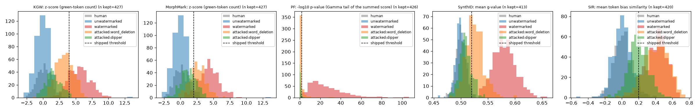
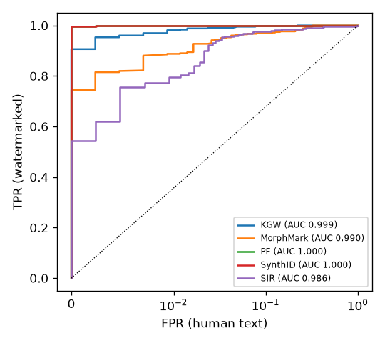
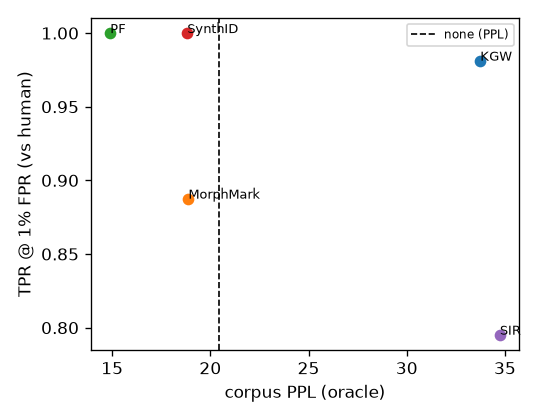
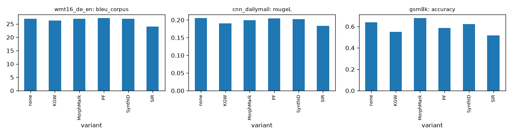

# wmbench results: `qwen15b-20261020-142513`

Model: `Qwen/Qwen2.5-1.5B-Instruct` | oracle: `Qwen/Qwen2.5-7B-Instruct` | device: cuda (bfloat16) | MarkLLM: `0a4fe8c6` | config hash: `8a54ca9d6d84`

## Main table

| variant | ppl_corpus | ppl_median | diversity | tok/s | n_err | bleu | rougeL | gsm8k_acc | auroc_vs_human | tpr@1%fpr_vs_human | auroc_vs_none | tpr@1%fpr_vs_none | fixed_thr_tpr | fixed_thr_fpr | attacked_tpr_word_deletion | attacked_tpr_dipper |
|---|---|---|---|---|---|---|---|---|---|---|---|---|---|---|---|---|
| none | 20.462 | 19.800 | 0.973 | 73.579 | 0 | 27.000 | 0.205 | 0.638 | - | - | - | - | - | - | - | - |
| KGW | 33.743 | 33.924 | 0.976 | 72.366 | 0 | 26.286 | 0.190 | 0.550 | 0.999 | 0.981 | 0.997 | 0.984 | 0.834 | 0.000 | 0.740 | 0.230 |
| MorphMark | 18.884 | 17.533 | 0.966 | 70.940 | 0 | 26.877 | 0.199 | 0.678 | 0.990 | 0.888 | 0.989 | 0.874 | 0.941 | 0.026 | 0.513 | 0.148 |
| PF | 14.903 | 14.710 | 0.960 | 74.265 | 0 | 27.150 | 0.204 | 0.587 | 1.000 | 1.000 | 1.000 | 1.000 | 1.000 | 0.002 | 0.181 | 0.064 |
| SynthID | 18.828 | 17.561 | 0.975 | 68.550 | 0 | 26.928 | 0.202 | 0.623 | 1.000 | 1.000 | 1.000 | 1.000 | 1.000 | 0.012 | 0.583 | 0.140 |
| SIR | 34.745 | 34.556 | 0.978 | 38.343 | 0 | 23.972 | 0.184 | 0.518 | 0.986 | 0.795 | 0.986 | 0.843 | 0.955 | 0.036 | 0.762 | 0.162 |
| human | 20.937 | 20.536 | 0.949 | - | 0 | - | - | - | - | - | - | - | - | - | - | - |

Detection columns use C4 continuations; negatives are human continuations (`vs_human`) or the `none` variant's generations (`vs_none`). Per sample and variant the watermarked, human and `none` texts are scored at one common token budget (the shortest of the three, at most `max_new_tokens`); samples whose budget is below `min_detect_tokens` (50) are excluded (`n_gen_ok` vs `n_samples_kept` in detection_summary.csv). `fixed_thr_*` use each algorithm's shipped threshold. `attacked_tpr_<attack>` is the TPR of the attacked watermarked texts at the threshold fixed on the clean human negatives; attack strength is in `attack_len_ratio_*`, `attack_bleu_vs_source_*` and `attack_sim_embed_*` of detection_summary.csv. `tpr@1%fpr` is unreliable when fewer than 100 negatives are available (see `fpr_warning_*` in detection_summary.csv).

## Quality degradation vs. unwatermarked (%)

Same prompts for every variant. `change_pct` = watermarked / unwatermarked - 1, with a paired bootstrap 95% CI. `better` says which direction is an improvement (perplexity: lower). GSM8K: 1 answer(s) per question, averaged per question before pairing, so the bootstrap resamples whole questions.

| dataset | metric | better | variant | n_pairs | none | watermarked | change_pct | change_pct_ci |
|---|---|---|---|---|---|---|---|---|
| c4 | perplexity (oracle) | lower | KGW | 500 | 23.552 | 35.957 | 52.669 | [35.7, 70.5] |
| c4 | diversity | higher | KGW | 500 | 0.973 | 0.976 | 0.240 | [-0.3, 0.9] |
| c4 | perplexity (oracle) | lower | MorphMark | 500 | 23.552 | 20.052 | -14.862 | [-24.1, -3.8] |
| c4 | diversity | higher | MorphMark | 500 | 0.973 | 0.966 | -0.718 | [-1.6, 0.1] |
| c4 | perplexity (oracle) | lower | PF | 500 | 23.552 | 17.138 | -27.233 | [-35.3, -18.8] |
| c4 | diversity | higher | PF | 500 | 0.973 | 0.960 | -1.337 | [-2.4, -0.5] |
| c4 | perplexity (oracle) | lower | SynthID | 500 | 23.552 | 20.262 | -13.972 | [-23.9, -2.0] |
| c4 | diversity | higher | SynthID | 500 | 0.973 | 0.975 | 0.206 | [-0.4, 0.9] |
| c4 | perplexity (oracle) | lower | SIR | 500 | 23.552 | 36.705 | 55.842 | [38.5, 76.6] |
| c4 | diversity | higher | SIR | 500 | 0.973 | 0.978 | 0.451 | [-0.2, 1.2] |
| wmt16_de_en | BLEU (sentence mean) | higher | KGW | 200 | 24.806 | 24.487 | -1.285 | [-7.7, 6.1] |
| wmt16_de_en | BLEU (sentence mean) | higher | MorphMark | 200 | 24.806 | 24.830 | 0.097 | [-6.9, 7.1] |
| wmt16_de_en | BLEU (sentence mean) | higher | PF | 200 | 24.806 | 24.169 | -2.567 | [-8.9, 3.2] |
| wmt16_de_en | BLEU (sentence mean) | higher | SynthID | 200 | 24.806 | 24.985 | 0.723 | [-5.5, 7.6] |
| wmt16_de_en | BLEU (sentence mean) | higher | SIR | 200 | 24.806 | 22.632 | -8.764 | [-15.0, -2.5] |
| cnn_dailymail | ROUGE-L | higher | KGW | 100 | 0.205 | 0.190 | -7.178 | [-12.9, -1.5] |
| cnn_dailymail | ROUGE-L | higher | MorphMark | 100 | 0.205 | 0.199 | -2.711 | [-8.9, 3.1] |
| cnn_dailymail | ROUGE-L | higher | PF | 100 | 0.205 | 0.204 | -0.321 | [-6.7, 6.3] |
| cnn_dailymail | ROUGE-L | higher | SynthID | 100 | 0.205 | 0.202 | -1.400 | [-6.7, 4.4] |
| cnn_dailymail | ROUGE-L | higher | SIR | 100 | 0.205 | 0.184 | -10.364 | [-16.1, -4.2] |
| gsm8k | accuracy | higher | KGW | 1319 | 0.638 | 0.550 | -13.895 | [-18.1, -9.4] |
| gsm8k | accuracy | higher | MorphMark | 1319 | 0.638 | 0.678 | 6.176 | [2.1, 10.7] |
| gsm8k | accuracy | higher | PF | 1319 | 0.638 | 0.587 | -8.076 | [-12.3, -3.6] |
| gsm8k | accuracy | higher | SynthID | 1319 | 0.638 | 0.623 | -2.375 | [-6.4, 2.0] |
| gsm8k | accuracy | higher | SIR | 1319 | 0.638 | 0.518 | -18.884 | [-23.1, -14.5] |

## Detection

| dataset | variant | score | n_gen_ok | n_samples_kept | n_pos | n_pos_nan | pos_mean | detect_tokens_mean | pos_tokens_mean | n_neg_human | neg_tokens_mean_human | neg_mean_human | auroc_human | auroc_human_ci | tpr@1%fpr_human | tpr@5%fpr_human | tpr@1%fpr_human_ci | best_f1_human | fixed_thr_tpr_human | fixed_thr_fpr_human | fpr_warning_human | n_neg_none | neg_tokens_mean_none | neg_mean_none | auroc_none | auroc_none_ci | tpr@1%fpr_none | tpr@5%fpr_none | tpr@1%fpr_none_ci | best_f1_none | fixed_thr_tpr_none | fixed_thr_fpr_none | fpr_warning_none | attacks | attacked_n_word_deletion | attacked_tpr_at_clean_thr_word_deletion | attacked_auroc_human_word_deletion | attacked_fixed_thr_tpr_word_deletion | attacked_tokens_mean_word_deletion | attack_len_ratio_word_deletion | attack_bleu_vs_source_word_deletion | attack_sim_embed_word_deletion | attacked_n_dipper | attacked_tpr_at_clean_thr_dipper | attacked_auroc_human_dipper | attacked_fixed_thr_tpr_dipper | attacked_tokens_mean_dipper | attack_len_ratio_dipper | attack_bleu_vs_source_dipper | attack_sim_embed_dipper | fixed_threshold | nominal_fpr |
|---|---|---|---|---|---|---|---|---|---|---|---|---|---|---|---|---|---|---|---|---|---|---|---|---|---|---|---|---|---|---|---|---|---|---|---|---|---|---|---|---|---|---|---|---|---|---|---|---|---|---|---|---|
| c4 | KGW | z-score (green-token count) | 500 | 427 | 427 | 0 | 5.547 | 122.946 | 122.946 | 427 | 122.946 | 0.104 | 0.999 | [1.00, 1.00] | 0.981 | 0.995 | [0.95, 1.00] | 0.987 | 0.834 | 0.000 | False | 427 | 122.946 | -0.023 | 0.997 | [0.99, 1.00] | 0.984 | 0.995 | [0.94, 1.00] | 0.988 | 0.834 | 0.002 | False | word_deletion, dipper | 427 | 0.740 | 0.975 | 0.295 | 85.681 | 0.696 | 40.385 | 0.891 | 427 | 0.230 | 0.822 | 0.016 | 116.126 | 1.007 | 26.933 | 0.841 | 4.000 | 0.000 |
| c4 | MorphMark | z-score (green-token count) | 500 | 427 | 427 | 0 | 4.320 | 119.836 | 119.836 | 427 | 119.836 | 0.091 | 0.990 | [0.99, 0.99] | 0.888 | 0.963 | [0.80, 0.94] | 0.959 | 0.941 | 0.026 | False | 427 | 119.836 | 0.001 | 0.989 | [0.98, 0.99] | 0.874 | 0.951 | [0.81, 0.94] | 0.955 | 0.941 | 0.033 | False | word_deletion, dipper | 427 | 0.513 | 0.940 | 0.684 | 83.834 | 0.701 | 40.563 | 0.894 | 427 | 0.148 | 0.770 | 0.253 | 111.190 | 0.980 | 28.876 | 0.835 | 2.000 | 0.023 |
| c4 | PF | -log10 p-value (Gamma tail of the summed score) | 500 | 426 | 426 | 0 | 26.754 | 119.615 | 119.615 | 426 | 119.615 | 0.452 | 1.000 | [1.00, 1.00] | 1.000 | 1.000 | [1.00, 1.00] | 0.999 | 1.000 | 0.002 | False | 426 | 119.615 | 0.442 | 1.000 | [1.00, 1.00] | 1.000 | 1.000 | [1.00, 1.00] | 0.998 | 1.000 | 0.014 | False | word_deletion, dipper | 426 | 0.181 | 0.712 | 0.178 | 83.322 | 0.697 | 40.770 | 0.893 | 425 | 0.064 | 0.609 | 0.059 | 108.073 | 0.941 | 31.911 | 0.830 | 2.000 | 0.010 |
| c4 | SynthID | mean g-value | 500 | 413 | 413 | 0 | 0.581 | 116.184 | 116.184 | 413 | 116.184 | 0.500 | 1.000 | [1.00, 1.00] | 1.000 | 1.000 | [1.00, 1.00] | 0.999 | 1.000 | 0.012 | False | 413 | 116.184 | 0.500 | 1.000 | [1.00, 1.00] | 1.000 | 1.000 | [1.00, 1.00] | 1.000 | 1.000 | 0.024 | False | word_deletion, dipper | 412 | 0.583 | 0.920 | 0.617 | 81.082 | 0.698 | 40.570 | 0.885 | 413 | 0.140 | 0.697 | 0.155 | 107.755 | 0.980 | 29.677 | 0.838 | 0.520 | - |
| c4 | SIR | mean token bias similarity | 500 | 420 | 420 | 0 | 0.413 | 125.790 | 125.790 | 420 | 125.790 | 0.009 | 0.986 | [0.98, 0.99] | 0.795 | 0.962 | [0.61, 0.92] | 0.961 | 0.955 | 0.036 | False | 420 | 125.790 | 0.009 | 0.986 | [0.98, 0.99] | 0.843 | 0.960 | [0.60, 0.91] | 0.958 | 0.955 | 0.040 | False | word_deletion, dipper | 420 | 0.762 | 0.979 | 0.917 | 87.660 | 0.698 | 40.810 | 0.891 | 420 | 0.162 | 0.882 | 0.462 | 119.164 | 1.010 | 26.048 | 0.839 | 0.200 | - |

## Quality per dataset

| dataset | variant | n_ok | n_err | n_ok_quality | n_err_quality | cont_tokens_mean | gen_seconds_mean | tokens_per_second | ppl_corpus | ppl_median | ppl_mean | ppl_ci | diversity | rep_2 | log_diversity_markllm | oracle | bleu_corpus | bleu_sentence_mean | bleu_sentence_ci | answer_words_mean | n_bleu | rouge1 | rouge2 | rougeL | rougeL_ci | accuracy | accuracy_ci | n_questions | answers_per_question |
|---|---|---|---|---|---|---|---|---|---|---|---|---|---|---|---|---|---|---|---|---|---|---|---|---|---|---|---|---|---|
| c4 | none | 500 | 0 | 500 | 0 | 130.258 | 1.770 | 73.579 | 20.462 | 19.800 | 132.629 | [18.34, 21.88] | 0.973 | 0.022 | 11.884 | Qwen/Qwen2.5-7B-Instruct | - | - | - | - | - | - | - | - | - | - | - | - | - |
| c4 | KGW | 500 | 0 | 500 | 0 | 147.262 | 2.035 | 72.366 | 33.743 | 33.924 | 61.361 | [31.17, 37.16] | 0.976 | 0.020 | 11.169 | Qwen/Qwen2.5-7B-Instruct | - | - | - | - | - | - | - | - | - | - | - | - | - |
| c4 | MorphMark | 500 | 0 | 500 | 0 | 140.970 | 1.987 | 70.940 | 18.884 | 17.533 | 65.626 | [16.44, 19.21] | 0.966 | 0.027 | 11.095 | Qwen/Qwen2.5-7B-Instruct | - | - | - | - | - | - | - | - | - | - | - | - | - |
| c4 | PF | 500 | 0 | 500 | 0 | 136.160 | 1.833 | 74.265 | 14.903 | 14.710 | 207.978 | [14.01, 15.33] | 0.960 | 0.030 | 11.420 | Qwen/Qwen2.5-7B-Instruct | - | - | - | - | - | - | - | - | - | - | - | - | - |
| c4 | SynthID | 500 | 0 | 500 | 0 | 131.368 | 1.916 | 68.550 | 18.828 | 17.561 | 13081.045 | [16.43, 18.67] | 0.975 | 0.020 | 12.093 | Qwen/Qwen2.5-7B-Instruct | - | - | - | - | - | - | - | - | - | - | - | - | - |
| c4 | SIR | 500 | 0 | 500 | 0 | 146.196 | 3.813 | 38.343 | 34.745 | 34.556 | 395.781 | [31.46, 37.32] | 0.978 | 0.018 | 12.221 | Qwen/Qwen2.5-7B-Instruct | - | - | - | - | - | - | - | - | - | - | - | - | - |
| c4 | human | 0 | 0 | 500 | 0 | - | - | - | 20.937 | 20.536 | 23.698 | [19.78, 21.60] | 0.949 | 0.037 | 8.490 | Qwen/Qwen2.5-7B-Instruct | - | - | - | - | - | - | - | - | - | - | - | - | - |
| wmt16_de_en | none | 200 | 0 | 200 | 0 | 27.795 | 0.381 | 72.898 | - | - | - | - | - | - | - | - | 27.000 | 24.806 | [22.33, 27.33] | 22.265 | 200.000 | - | - | - | - | - | - | - | - |
| wmt16_de_en | KGW | 200 | 0 | 200 | 0 | 27.480 | 0.389 | 70.557 | - | - | - | - | - | - | - | - | 26.286 | 24.487 | [22.09, 26.82] | 21.860 | 200.000 | - | - | - | - | - | - | - | - |
| wmt16_de_en | MorphMark | 200 | 0 | 200 | 0 | 27.105 | 0.394 | 68.791 | - | - | - | - | - | - | - | - | 26.877 | 24.830 | [22.14, 27.46] | 21.495 | 200.000 | - | - | - | - | - | - | - | - |
| wmt16_de_en | PF | 200 | 0 | 200 | 0 | 27.480 | 0.380 | 72.322 | - | - | - | - | - | - | - | - | 27.150 | 24.169 | [21.75, 26.39] | 21.760 | 200.000 | - | - | - | - | - | - | - | - |
| wmt16_de_en | SynthID | 200 | 0 | 200 | 0 | 27.070 | 0.413 | 65.598 | - | - | - | - | - | - | - | - | 26.928 | 24.985 | [22.53, 27.52] | 21.670 | 200.000 | - | - | - | - | - | - | - | - |
| wmt16_de_en | SIR | 200 | 0 | 200 | 0 | 27.500 | 0.718 | 38.277 | - | - | - | - | - | - | - | - | 23.972 | 22.632 | [20.21, 24.83] | 21.275 | 200.000 | - | - | - | - | - | - | - | - |
| cnn_dailymail | none | 100 | 0 | 100 | 0 | 85.620 | 1.139 | 75.186 | - | - | - | - | - | - | - | - | - | - | - | 68.580 | - | 0.293 | 0.095 | 0.205 | [0.19, 0.22] | - | - | - | - |
| cnn_dailymail | KGW | 100 | 0 | 100 | 0 | 88.080 | 1.212 | 72.694 | - | - | - | - | - | - | - | - | - | - | - | 70.320 | - | 0.284 | 0.092 | 0.190 | [0.18, 0.20] | - | - | - | - |
| cnn_dailymail | MorphMark | 100 | 0 | 100 | 0 | 88.550 | 1.252 | 70.745 | - | - | - | - | - | - | - | - | - | - | - | 71.090 | - | 0.286 | 0.094 | 0.199 | [0.18, 0.21] | - | - | - | - |
| cnn_dailymail | PF | 100 | 0 | 100 | 0 | 87.560 | 1.218 | 71.910 | - | - | - | - | - | - | - | - | - | - | - | 68.460 | - | 0.291 | 0.103 | 0.204 | [0.19, 0.22] | - | - | - | - |
| cnn_dailymail | SynthID | 100 | 0 | 100 | 0 | 86.100 | 1.267 | 67.952 | - | - | - | - | - | - | - | - | - | - | - | 68.460 | - | 0.305 | 0.097 | 0.202 | [0.19, 0.22] | - | - | - | - |
| cnn_dailymail | SIR | 100 | 0 | 100 | 0 | 84.770 | 2.930 | 28.934 | - | - | - | - | - | - | - | - | - | - | - | 67.550 | - | 0.276 | 0.085 | 0.184 | [0.17, 0.20] | - | - | - | - |
| gsm8k | none | 1319 | 0 | 1319 | 0 | 300.030 | 3.975 | 75.477 | - | - | - | - | - | - | - | - | - | - | - | - | - | - | - | - | - | 0.638 | [0.61, 0.66] | 1319.000 | 1.000 |
| gsm8k | KGW | 1319 | 0 | 1319 | 0 | 293.136 | 4.017 | 72.966 | - | - | - | - | - | - | - | - | - | - | - | - | - | - | - | - | - | 0.550 | [0.52, 0.58] | 1319.000 | 1.000 |
| gsm8k | MorphMark | 1319 | 0 | 1319 | 0 | 296.036 | 4.179 | 70.841 | - | - | - | - | - | - | - | - | - | - | - | - | - | - | - | - | - | 0.678 | [0.65, 0.70] | 1319.000 | 1.000 |
| gsm8k | PF | 1319 | 0 | 1319 | 0 | 300.425 | 4.014 | 74.852 | - | - | - | - | - | - | - | - | - | - | - | - | - | - | - | - | - | 0.587 | [0.56, 0.61] | 1319.000 | 1.000 |
| gsm8k | SynthID | 1319 | 0 | 1319 | 0 | 284.832 | 4.122 | 69.105 | - | - | - | - | - | - | - | - | - | - | - | - | - | - | - | - | - | 0.623 | [0.60, 0.65] | 1319.000 | 1.000 |
| gsm8k | SIR | 1319 | 0 | 1319 | 0 | 300.613 | 8.552 | 35.151 | - | - | - | - | - | - | - | - | - | - | - | - | - | - | - | - | - | 0.518 | [0.49, 0.54] | 1319.000 | 1.000 |

## Paired differences vs `none` (same prompts, bootstrap 95% CI)

| dataset | variant | metric | n_pairs | delta_vs_none | ci_low | ci_high | base_mean | variant_mean | rel_change_pct | rel_ci_low | rel_ci_high |
|---|---|---|---|---|---|---|---|---|---|---|---|
| c4 | KGW | log_ppl | 500 | 0.423 | 0.305 | 0.534 | 23.552 | 35.957 | 52.669 | 35.666 | 70.543 |
| c4 | KGW | diversity | 500 | 0.002 | -0.003 | 0.009 | 0.973 | 0.976 | 0.240 | -0.350 | 0.878 |
| c4 | MorphMark | log_ppl | 500 | -0.161 | -0.276 | -0.039 | 23.552 | 20.052 | -14.862 | -24.111 | -3.827 |
| c4 | MorphMark | diversity | 500 | -0.007 | -0.015 | 0.001 | 0.973 | 0.966 | -0.718 | -1.574 | 0.147 |
| c4 | PF | log_ppl | 500 | -0.318 | -0.435 | -0.209 | 23.552 | 17.138 | -27.233 | -35.261 | -18.839 |
| c4 | PF | diversity | 500 | -0.014 | -0.023 | -0.005 | 0.973 | 0.960 | -1.337 | -2.354 | -0.502 |
| c4 | SynthID | log_ppl | 500 | -0.150 | -0.273 | -0.021 | 23.552 | 20.262 | -13.972 | -23.902 | -2.044 |
| c4 | SynthID | diversity | 500 | 0.002 | -0.004 | 0.009 | 0.973 | 0.975 | 0.206 | -0.436 | 0.929 |
| c4 | SIR | log_ppl | 500 | 0.444 | 0.326 | 0.569 | 23.552 | 36.705 | 55.842 | 38.528 | 76.629 |
| c4 | SIR | diversity | 500 | 0.004 | -0.002 | 0.011 | 0.973 | 0.978 | 0.451 | -0.241 | 1.168 |
| wmt16_de_en | KGW | bleu_sentence | 200 | -0.319 | -2.022 | 1.429 | 24.806 | 24.487 | -1.285 | -7.687 | 6.101 |
| wmt16_de_en | MorphMark | bleu_sentence | 200 | 0.024 | -1.680 | 1.671 | 24.806 | 24.830 | 0.097 | -6.900 | 7.094 |
| wmt16_de_en | PF | bleu_sentence | 200 | -0.637 | -2.376 | 0.771 | 24.806 | 24.169 | -2.567 | -8.885 | 3.186 |
| wmt16_de_en | SynthID | bleu_sentence | 200 | 0.179 | -1.356 | 1.880 | 24.806 | 24.985 | 0.723 | -5.504 | 7.603 |
| wmt16_de_en | SIR | bleu_sentence | 200 | -2.174 | -3.900 | -0.588 | 24.806 | 22.632 | -8.764 | -15.030 | -2.451 |
| cnn_dailymail | KGW | rougeL | 100 | -0.015 | -0.027 | -0.003 | 0.205 | 0.190 | -7.178 | -12.898 | -1.496 |
| cnn_dailymail | MorphMark | rougeL | 100 | -0.006 | -0.018 | 0.006 | 0.205 | 0.199 | -2.711 | -8.865 | 3.114 |
| cnn_dailymail | PF | rougeL | 100 | -0.001 | -0.014 | 0.013 | 0.205 | 0.204 | -0.321 | -6.688 | 6.289 |
| cnn_dailymail | SynthID | rougeL | 100 | -0.003 | -0.014 | 0.009 | 0.205 | 0.202 | -1.400 | -6.678 | 4.444 |
| cnn_dailymail | SIR | rougeL | 100 | -0.021 | -0.034 | -0.008 | 0.205 | 0.184 | -10.364 | -16.095 | -4.181 |
| gsm8k | KGW | accuracy | 1319 | -0.089 | -0.118 | -0.058 | 0.638 | 0.550 | -13.895 | -18.077 | -9.437 |
| gsm8k | MorphMark | accuracy | 1319 | 0.039 | 0.014 | 0.067 | 0.638 | 0.678 | 6.176 | 2.071 | 10.728 |
| gsm8k | PF | accuracy | 1319 | -0.052 | -0.080 | -0.023 | 0.638 | 0.587 | -8.076 | -12.281 | -3.582 |
| gsm8k | SynthID | accuracy | 1319 | -0.015 | -0.041 | 0.013 | 0.638 | 0.623 | -2.375 | -6.401 | 2.049 |
| gsm8k | SIR | accuracy | 1319 | -0.121 | -0.151 | -0.090 | 0.638 | 0.518 | -18.884 | -23.077 | -14.542 |

## Plots

